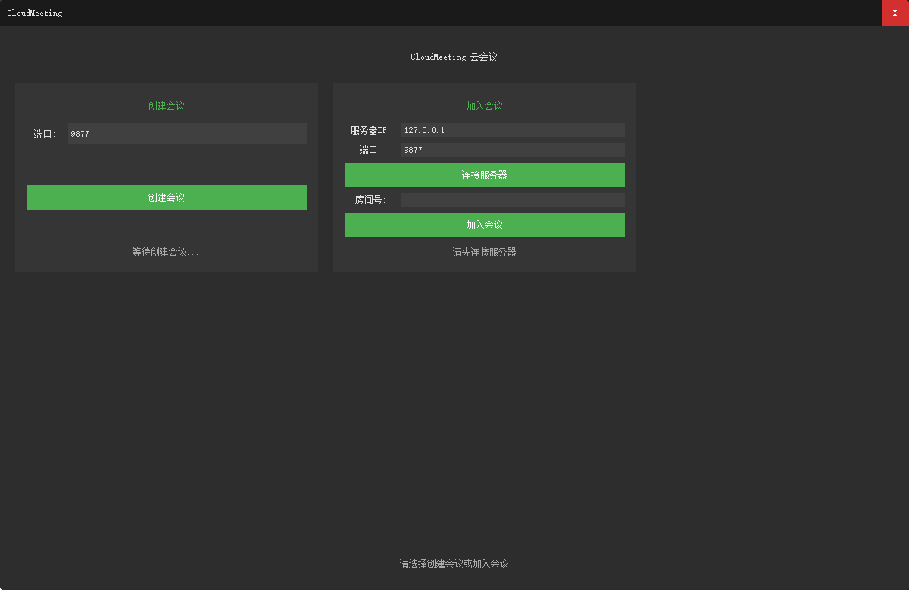
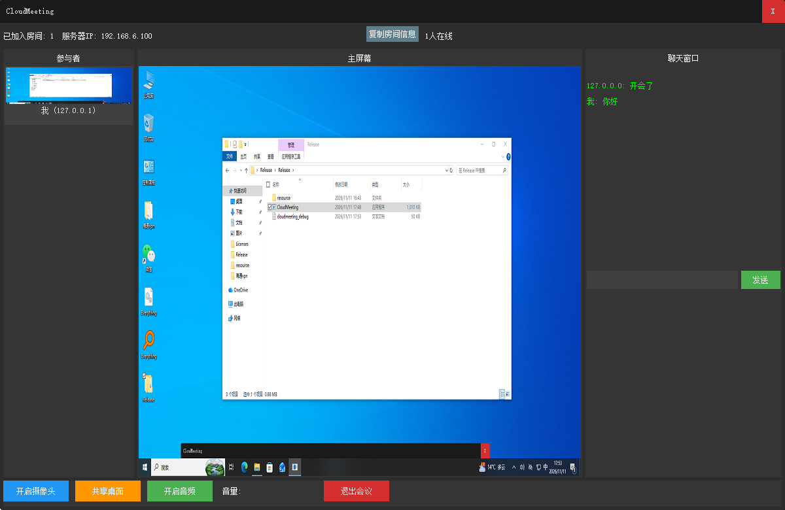

# CloudMeeting 局域网视频会议

一个使用 C++ / DuiLib 自研 UI 的**局域网视频会议客户端**，支持多人在同一局域网内创建/加入会议房间，进行桌面共享、摄像头共享、语音通话和文字聊天，类似简化版的腾讯会议。

## 界面效果图

**启动页面**（创建会议 / 加入会议）：



**会议房间**（主屏幕显示共享画面、左侧参与者列表、右侧聊天窗口）：



## 功能特性

- **创建会议**：任一台机器可创建房间，自动分配房间号，支持多房间并发（默认最多 8 个）
- **加入会议**：输入服务器 IP + 房间号即可加入，加入后可看到全部成员
- **参与者列表**：实时显示所有成员（含自己），成员进出自动更新
- **主画面切换**：点击参与者窗格即可把该成员的共享画面放大到中间主屏幕观看，选中项高亮
- **桌面共享**：GDI 抓屏，全帧共享当前桌面，画面自动降采样 + 限帧控制带宽
- **摄像头共享**：Media Foundation 采集，与桌面共享互斥切换
- **语音通话**：8kHz/16bit PCM 采集与播放，**多路真实混音**——多人同时说话可同时听到（按来源分轨、采样级叠加、削波保护）
- **文字聊天**：全员群聊，显示发送者 IP
- **房间信息复制**：一键复制房间号与服务器 IP，方便分享
- **干净退出**：退出会议返回启动页并完整复位状态；关闭窗口无进程残留

## 技术架构

```
┌─────────────────────────── CloudMeeting.exe ───────────────────────────┐
│  UI 层 (DuiLib 自研扩展)      核心层                      媒体层         │
│  ├─ main_wnd        ↔  ├─ MeetingManager(单例)  ↔  ├─ VideoCapture(MF) │
│  ├─ CCreateMeetingUI          │   角色管理/回调分发         ├─ AudioCapture(MF)│
│  ├─ CJoinMeetingUI            ├─ ServerLogic(TCP服务端)    ├─ DesktopCapture(GDI)│
│  ├─ CMeetingRoomUI            │   房间管理/收发循环/广播    ├─ AudioPlayer(waveOut混音)│
│  └─ ui_video_display          └─ ClientLogic(TCP客户端)    └─ MediaManager(统一停止) │
│     RemoteFrameStore(远端帧缓存)                                        │
└─────────────────────────────────────────────────────────────────────────┘
```

| 模块 | 说明 |
|------|------|
| `src/core/meeting_manager.*` | 会议管理单例：服务器/客户端角色切换、消息分发回调、视频帧节流与降采样 |
| `src/core/server_logic.*` | TCP 服务端：房间分配、客户端收发循环（select）、媒体/文本广播、本地房主通道 |
| `src/core/client_logic.*` | TCP 客户端：连接管理、接收/发送线程、媒体帧丢帧保护 |
| `src/core/remote_frame_store.*` | 按 IP 缓存各远端成员的最新视频帧（网络线程写、UI 线程读） |
| `src/net/tcp_socket.*` | Socket 封装：连接、收发（Readn/Writen）、本端/对端地址获取 |
| `src/net/net_utils.*` | 本机 IP 探测（默认路由出口探测，防虚拟网卡干扰） |
| `src/media/*` | 视频采集（Media Foundation）、桌面采集（GDI）、音频采集与混音播放（waveOut） |
| `src/ui/*` | DuiLib 界面：主窗口、创建/加入/房间三个页面节点（CNodeUI 消息广播机制） |
| `3dparty/DuiLib` | 自研 DuiLib（静态库，预编译缓存，仅首次构建编译） |

**通信协议**：自定义 TCP 帧格式 `$type(2B) + ip(4B) + len(4B) + data + #`，消息类型涵盖建房/加入/退出响应、成员进出、视频/音频/聊天转发等。媒体帧在队列积压时丢弃（不阻塞采集线程），音频走优先通道。

## 构建方法

**环境要求**：
- Windows 10/11
- Visual Studio 2022（含 C++ 桌面开发）
- CMake ≥ 3.20

```bat
:: 一键构建（首次会自动编译 DuiLib 静态库，之后增量编译主工程）
build.bat
```

产物：`build\Release\CloudMeeting.exe`

> 说明：DuiLib 采用预编译策略——只要 `build\3dparty\DuiLib\Release\duilib_static.lib` 存在就直接链接，不再重编；若修改了 DuiLib 源码，需删除该 `.lib` 或整个 `build` 目录后重新构建。

## 使用说明

1. **创建会议**：在一台机器（如虚拟机）上启动程序，左侧输入端口（默认 9877）→ 点击"创建会议"→ 得到房间号
2. **加入会议**：局域网内其他机器启动程序，右侧输入服务器 IP（创建者机器的 IP）+ 端口 → "连接服务器" → 输入房间号 → "加入会议"
3. 会中可随时：开启摄像头 / 共享桌面（二选一自动切换）/ 开启音频 / 发送聊天
4. **点击参与者窗格**可将其画面切换到中间主屏幕放大观看
5. 点击"复制房间信息"把房间号和服务器 IP 复制到剪贴板分享
6. "退出会议"返回启动页，可直接再次创建或加入

## 目录结构

```
CloudMeeting/
├── build.bat              # 一键构建脚本
├── CMakeLists.txt         # 主工程（DuiLib 预编译链接策略）
├── 3dparty/DuiLib/        # 自研 DuiLib（静态库）
├── src/
│   ├── core/              # 会议/房间/消息核心逻辑
│   ├── net/               # TCP Socket 封装
│   ├── media/             # 音视频采集、桌面采集、混音播放
│   ├── ui/                # DuiLib 界面与 XML 资源（resource/*.xml）
│   └── main.cpp           # 入口（含崩溃捕获）
└── Image/                 # 界面效果图
```

## 已知限制

- 仅支持同一局域网内使用，未做公网穿透与加密
- 视频为 RGB32 裸帧 + 降采样限帧，未做 H.264/JPEG 编码，高分辨率桌面共享下画质与流畅度受局域网带宽限制
- 音频为 8kHz 单声道（对讲机音质），如需更清晰可升级采集/播放采样率
- 摄像头与桌面共享互斥，同一时刻只能共享一路视频
